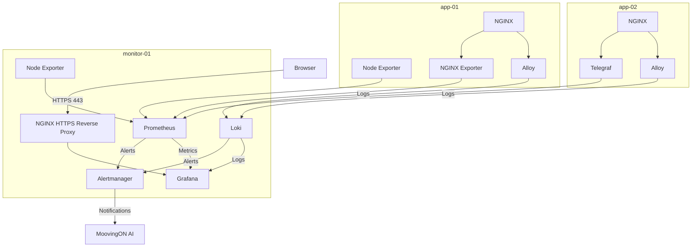

# Observability Onboarding Lab

A hands-on observability platform built with Docker Compose and Linux systemd services on three AWS EC2 instances.

The goal is to collect metrics and logs, visualize infrastructure health, and send alerts to MoovingON AI.

## Infrastructure

| Server | Role |
|---|---|
| monitor-01 | Central monitoring: Prometheus, Grafana, Loki, Alertmanager |
| app-01 | NGINX, Node Exporter, NGINX Exporter, Alloy |
| app-02 | NGINX, Telegraf, Alloy |

The environment currently uses temporary AWS EC2 instances. The configuration is maintained in Git to support future migration.

## Servers & Ports

| Server | Service | Port | Access |
|---|---|---|---|
| monitor-01 | NGINX HTTPS Reverse Proxy | 443 | HTTPS, firewall restricted |
| monitor-01 | Grafana | 3000 | Localhost only |
| monitor-01 | Prometheus | 9090 | Localhost only |
| monitor-01 | Alertmanager | 9093 | Localhost only |
| monitor-01 | Loki | 3100 | Private VPC address |
| monitor-01 | Node Exporter | 9100 | TLS and Basic Auth, firewall restricted |
| app-01 | NGINX Web Server | 80 | Firewall restricted |
| app-01 | NGINX Stub Status | 8080 | Localhost only |
| app-01 | Node Exporter | 9100 | TLS and Basic Auth, firewall restricted |
| app-01 | NGINX Exporter | 9113 | Internal monitoring access |
| app-02 | NGINX Web Server | 80 | Firewall restricted |
| app-02 | NGINX Stub Status | 8080 | Localhost only |
| app-02 | Telegraf Metrics | 9273 | Internal monitoring access |

Prometheus, Grafana, Loki and Alertmanager run in Docker containers
on monitor-01. The exporters and Alloy run as systemd services.

AWS Security Groups and UFW control network access.
A listening port does not necessarily mean it is publicly reachable.

## Architecture Diagram



## How It Works

### Metrics

1. Node Exporter, NGINX Exporter and Telegraf expose metrics.
2. Prometheus collects these metrics every 15 seconds.
3. Grafana queries Prometheus and displays dashboards.
4. Prometheus evaluates alert rules and sends alerts to Alertmanager.

### Logs

1. NGINX and systemd generate logs on app-01 and app-02.
2. Grafana Alloy collects and labels the logs.
3. Alloy redacts selected sensitive values and sends logs to Loki.
4. Grafana queries Loki to display and investigate logs.

### Alerts

1. Prometheus and Loki evaluate alert rules.
2. Alerts are sent to Alertmanager.
3. Alertmanager routes notifications to MoovingON Stage.
4. Resolved alerts are also sent when the issue is cleared.

## Grafana Dashboards

All five dashboards are stored in Git and loaded through file provisioning:

- Infrastructure Overview
- NGINX Overview
- Telegraf Hosts
- Node Exporter Full
- Monitoring of the Monitoring

Dashboard files: `monitor-01/grafana/dashboards/`

## Security

- AWS Security Groups and UFW restrict network access.
- Grafana uses HTTPS through an NGINX reverse proxy.
- Prometheus and Alertmanager require Basic Auth.
- Node Exporters use HTTPS and Basic Auth.
- Services run with restricted permissions.
- Secrets are stored outside Git.
- Alloy redacts selected sensitive values from logs.
- Outbound internet access from monitor-01 is restricted by AWS Security Group rules.

The Stage API allowlist currently uses IP addresses. These may change and must be maintained.

## Git Workflow

Feature branch → Commit → Push → Pull Request → Review → Merge.

## Documentation

- `NOTES.md` — Learning notes and problems encountered.
- `TROUBLESHOOTING.md` — Common monitoring and alert delivery issues.
- `UPDATE_PROCEDURE.md — Safe update and rollback procedure.
- `monitor-01/README.md` — Monitoring server configuration.
- `runbooks/` — Runbooks for all eight alerts.

## Deployment from Scratch

This deployment uses three Ubuntu EC2 servers:
`monitor-01`, `app-01`, and `app-02`.

Configuration is version-controlled in Git. Secrets,
TLS certificates, cloud networking, and service installation
require additional setup.

### 1. Prepare the Servers

1. Create three Ubuntu EC2 instances in the same VPC.
2. Configure hostnames and private DNS or `/etc/hosts`.
3. Configure SSH access between the monitoring server and app servers.
4. Configure AWS Security Groups and UFW.
5. Allow only the required monitoring ports and trusted sources.
6. Synchronize server clocks using NTP.

See the **Servers & Ports** table above.

Do not copy the lab's existing private IP addresses to new servers.

### 2. Set Up monitor-01

Install Docker Engine, the Docker Compose plugin, NGINX,
and Node Exporter.

Verify Docker:

```bash
docker --version
docker compose version
```

Clone the repository:

```bash
git clone git@github.com:LoaiSaadi/observability-lab.git ~/observability-lab
cd ~/observability-lab/monitor-01
```

Replace environment-specific addresses in the configuration,
including the Loki port binding in `docker-compose.yml`
and monitoring targets in `prometheus/prometheus.yml`.

### 3. Configure Secrets

Create the local environment file:

```bash
cp .env.example .env
chmod 600 .env
```

Populate the required Grafana, Prometheus, and Alertmanager
credentials using securely generated values.

The following files are required by the Compose mounts
and must be provisioned securely outside Git:

- `prometheus/secrets/web.yml`
- `prometheus/secrets/scrape-password`
- `prometheus/secrets/app-01.crt`
- `prometheus/secrets/app-01-password`
- `prometheus/secrets/monitor-01.crt`
- `prometheus/secrets/monitor-01-password`
- `alertmanager/secrets/web.yml`
- `alertmanager/secrets/client-password`

Also provision any additional credential files referenced by
`alertmanager/alertmanager.yml`.

The file `alertmanager/secrets/client-password` is also mounted
inside Prometheus as `/etc/prometheus/alertmanager-password`.
It is used for authenticated Alertmanager API access and scraping.
No separate host-side `alertmanager-password` file is required.

Install the required certificates and credentials for
Node Exporter HTTPS and Basic Auth.

Never commit passwords, TLS private keys, or secret files.

### 4. Start the Monitoring Containers

Validate the Compose configuration:

```bash
docker compose config -q
```

Start the stack:

```bash
docker compose up -d
```

Check container status:

```bash
docker compose ps
```

Expected services:

- Prometheus
- Grafana
- Loki
- Alertmanager

All containers should be running.

### 5. Configure HTTPS Access

Install NGINX on the monitoring host.

Use `monitor-01/nginx/grafana.conf` as the reference
configuration for the Grafana reverse proxy.

For this lab, HTTPS was configured using `mkcert`.

1. Install `mkcert` on the administrator's workstation.
2. Create a locally trusted CA using `mkcert -install`.
3. Generate a certificate for the Grafana hostname:

```bash
mkcert -cert-file grafana.crt -key-file grafana.key monitor-01
```

4. Securely copy the certificate and private key to monitor-01.
5. Install them at the paths configured in NGINX:

```bash
sudo install -D -m 644 grafana.crt /etc/nginx/ssl/grafana.crt
sudo install -D -m 600 grafana.key /etc/nginx/ssl/grafana.key
sudo nginx -t
sudo systemctl reload nginx
```

These installation commands assume the files have already been
copied into the current directory on monitor-01.

The certificate is trusted only on devices that trust the
corresponding mkcert CA. For production or access from unrelated
devices, use a certificate issued by a trusted CA.

Never commit TLS private keys or the mkcert root CA private key.

Grafana listens on localhost port 3000.
External browser access uses HTTPS port 443 through NGINX.

### 6. Verify the Monitoring Stack

- Confirm all four Docker containers are running.
- Confirm Node Exporter is running as a systemd service.
- Confirm Grafana is accessible over HTTPS.
- Confirm Prometheus and Alertmanager require authentication.
- Confirm the Prometheus, Loki and Alertmanager data sources are available.
- Confirm all five provisioned Grafana dashboards appear.
- Confirm Prometheus targets are UP after agent deployment.
- Confirm Loki receives logs from both application servers.
- Trigger a controlled test alert and verify its recovery.

### 7. Deploy Application Agents

Both application servers run NGINX and Grafana Alloy.
Their metrics collectors differ:

| Server | Metrics collector | Port |
|---|---|---|
| app-01 | Node Exporter and NGINX Exporter | 9100, 9113 |
| app-02 | Telegraf | 9273 |

Install the required software before deploying configurations.

Versions verified in the current lab:

| Service | Version | Server |
|---|---|---|
| Node Exporter | 1.12.1 | app-01 |
| NGINX Exporter | 1.5.3 | app-01 |
| Grafana Alloy | 1.21.3 | app-01, app-02 |
| Telegraf | 1.40.3 | app-02 |

The commands below run on the relevant application server.
They assume the repository has been cloned there, or the required
configuration files have been securely copied to that server.
Run relative-path commands from the repository root.

#### app-01 — NGINX, Node Exporter, NGINX Exporter, Alloy

Install NGINX and configure the local status endpoint:

```bash
sudo install -m 644 app-01/nginx/status.conf /etc/nginx/conf.d/status.conf
sudo nginx -t
sudo systemctl reload nginx
curl http://127.0.0.1:8080/stub_status
```

Install the Node Exporter binary at
`/usr/local/bin/node_exporter`.

Create a dedicated `node_exporter` service user.

Install its systemd configuration:

```bash
sudo install -m 644 common/node_exporter.service /etc/systemd/system/node_exporter.service

sudo install -D -m 644 common/node_exporter-secure.override.conf /etc/systemd/system/node_exporter.service.d/override.conf
```

Before starting Node Exporter, provision its TLS certificate,
private key and Basic Auth configuration at
`/etc/node_exporter/web.yml` and the paths referenced by it.

Install the NGINX Prometheus Exporter binary at
`/usr/local/bin/nginx-prometheus-exporter`.

Create the dedicated `nginx_exporter` service user and group.

Install its systemd configuration:

```bash
sudo install -m 644 app-01/systemd/nginx-exporter.service /etc/systemd/system/nginx-exporter.service

sudo systemctl daemon-reload
sudo systemctl enable --now node_exporter nginx-exporter
```

Verify the NGINX Exporter:

```bash
curl http://127.0.0.1:9113/metrics
```

Install Grafana Alloy v1.21.3 using the approved package
repository. The package provides the `alloy` systemd service.

Deploy the version-controlled configuration:

```bash
sudo install -m 644 app-01/alloy/config.alloy /etc/alloy/config.alloy
sudo systemctl enable --now alloy
sudo systemctl restart alloy
sudo systemctl is-active alloy
```

The service uses `CONFIG_FILE="/etc/alloy/config.alloy"`
from `/etc/default/alloy`.

Ensure the `alloy` user has the required permissions to read
NGINX logs and the systemd journal.

#### app-02 — NGINX, Telegraf, Alloy

Install NGINX and configure the local status endpoint:

```bash
sudo install -m 644 app-02/nginx/status.conf /etc/nginx/conf.d/status.conf
sudo nginx -t
sudo systemctl reload nginx
curl http://127.0.0.1:8080/stub_status
```

Install Telegraf and deploy its configuration:

```bash
sudo install -m 644 app-02/telegraf/telegraf.conf /etc/telegraf/telegraf.conf

sudo systemctl enable --now telegraf
sudo systemctl restart telegraf
```

Verify Telegraf metrics:

```bash
curl -s http://127.0.0.1:9273/metrics | grep '^nginx_'
```

Install Grafana Alloy v1.21.3 using the approved package
repository. The package provides the `alloy` systemd service.

Deploy the version-controlled configuration:

```bash
sudo install -m 644 app-02/alloy/config.alloy /etc/alloy/config.alloy
sudo systemctl enable --now alloy
sudo systemctl restart alloy
sudo systemctl is-active alloy
```

The service uses `CONFIG_FILE="/etc/alloy/config.alloy"`
from `/etc/default/alloy`.

Ensure the `alloy` user has the required permissions to read
NGINX logs and the systemd journal.

#### Verify Both Application Servers

On each application server, check the installed services:

```bash
sudo systemctl status nginx
sudo systemctl status alloy
```

On app-01, also check:

```bash
sudo systemctl status node_exporter nginx-exporter
```

On app-02, also check:

```bash
sudo systemctl status telegraf
```

From monitor-01, verify that Prometheus targets are UP.

In Grafana Explore, verify that Loki receives access,
error and systemd journal logs from both servers.

The Alloy configuration sends logs to
`http://monitor-01:3100/loki/api/v1/push`.
Ensure this hostname resolves to the monitoring server's
private IP address.

## Adding a New Monitored Server

This procedure explains how to add another Linux server,
for example `app-03`, to the existing monitoring platform.

### 1. Prepare the New Server

- Assign a hostname and a private IP address.
- Configure DNS or `/etc/hosts` so the servers can communicate.
- Configure SSH access, AWS Security Groups and UFW.
- Install and enable Node Exporter as a systemd service.
- Configure Node Exporter with HTTPS and Basic Auth.
- Allow monitor-01 to access the exporter on TCP port 9100.

Use the existing files in `common/` as configuration examples.

### 2. Add the Server to Prometheus

On monitor-01, edit:

```text
monitor-01/prometheus/prometheus.yml
```

Add the new server to the existing Node Exporter scrape job.

Use the new server's private IP and port 9100.
Keep the existing authentication and TLS configuration.

Provision the new server's TLS certificate and credentials
securely, and update the Prometheus Docker Compose mounts
if additional secret files are required.

Do not remove existing monitoring targets.

Validate the configuration:

```bash
docker compose -f monitor-01/docker-compose.yml exec prometheus   promtool check config /etc/prometheus/prometheus.yml
```

Reload Prometheus after the new configuration is visible
inside the container. If a bind-mounted file still shows
the old content, recreate only the Prometheus container
without deleting its volumes.

### 3. Configure Log Collection (Optional)

If the new server requires log monitoring:

1. Install Grafana Alloy.
2. Use an existing Alloy configuration as a starting point.
3. Update the log paths for the new server.
4. Ensure the Alloy service can read the required logs.
5. Configure the Loki endpoint on monitor-01.
6. Enable and start the Alloy service.

Alloy should label the logs with the new server hostname.

Ensure the new server can reach Loki on TCP port 3100.

### 4. Verify the New Server

In Prometheus:

- Open Status > Targets.
- Confirm the new Node Exporter target is UP.
- Query the new server's CPU, memory and disk metrics.

In Grafana:

- Confirm the new server appears in infrastructure monitoring.
- Verify metrics are available for the new instance.
- If Alloy was installed, verify its logs in Loki Explore.

Test a controlled alert and confirm that both Firing and
Resolved notifications reach MoovingON AI.

### 5. Update Documentation

- Update the Servers & Ports table if needed.
- Update dashboard variables or filters if they use fixed host lists.
- Document the new hostname and service role.
- Commit the configuration changes through a Pull Request.

## Disaster Recovery Test

**Status:** Passed — November 17, 2026.

Grafana recovery was tested using a fresh, empty Docker volume,
without deleting the original production-like data volume.

Test procedure:
1. Backed up the original Grafana volume.
2. Validated the backup archive and SQLite database.
3. Recreated Grafana using a temporary empty volume.
4. Confirmed that Grafana data sources and all four dashboards
   were restored automatically through file provisioning.
5. Reconnected the original Grafana volume.
6. Confirmed the Grafana container was running.
7. Removed the temporary test volume.

Original volume: `monitor-01_grafana_data`

Backup: `~/grafana-backups/grafana-volume-current.tar.gz`

The original data volume was not deleted.
Manual Grafana settings and users still require backup
because file provisioning does not restore everything.

## Project Status

- Phases 1–9: Implemented and tested during the lab.
- Phase 10: Documentation, recovery testing and final demo preparation in progress.
